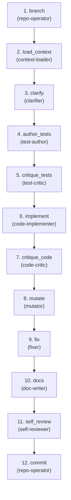

# Build — warm candidate construction and challenge

**Current responsibility:** Produce one coherent candidate with discriminating
proof, reviewable evidence and an honest remaining-risk boundary.

Build is not a fixed twelve-agent conveyor. Keep one writer and useful repository,
model, compiler and test context warm. Invoke the configured specialists when
they answer a useful question; the accountable root may perform bounded work and
must integrate every returned result.

## Enter from current work

Start with the selected issue or existing candidate. Inspect the real consumer,
current source, relevant decisions, existing proof and material findings. Earlier
Signal/Plan artifacts may help, but missing historical paperwork does not require
reconstructing the whole route.

Challenge the premise and proposed falsifier before implementation. Design tests
that reject plausible wrong behavior and reach the production decision. Record
the actual tested bytes, command, environment, selected/executed subjects,
outcome and limitations. HEAD alone does not identify dirty or staged proof.

Implement and repair through the current candidate writer. Revisit test oracle,
error/boundary behavior, compatibility, test cost, simplicity, documentation and
product fit as the work develops. Mutation, fuzzing and broad suites are selected
risk-directed instruments, not unconditional taxes on every edit.

Commit and publish coherent progress for recovery and review. In the target
lifecycle, publication does not request expensive qualification. If the installed
consumer still starts CI on push or Draft/Ready, report that current behavior and
use its authorized migration path rather than claiming the target is active.

A coherent candidate proceeds to Review. That does not mean independently
qualified, merge-authorized, released or installed.

## Generated demo topology

The block below is generated from `swarm/config/flows/build.yaml`. It remains a
compatibility/demo topology while #1463 migrates config and runtime semantics.
Step order and named agents are navigation, not mandatory fresh contexts or
exclusive authority.

<!-- FLOW AUTOGEN START -->
### Flow structure

### Steps

| # | Step | Agents | Role |
| - | ---- | ------ | ---- |
| 1 | `branch` | `repo-operator` — Git workflows: branch, commit, merge, tag. Safe Bash only. | Ensure clean tree, create feature branch with conventional naming. |
| 2 | `load_context` | `context-loader` — Load relevant code/tests/specs for subtask → subtask_context_manifest.json. | Load relevant context for subtask → subtask_context_manifest.json. |
| 3 | `clarify` | `clarifier` — Detect ambiguities, draft clarification questions. | Detect ambiguities, draft clarification questions → clarification_questions.md. |
| 4 | `author_tests` | `test-author` — Write/update tests → tests/*, test_changes_summary.md. | Write/update tests → tests/*, test_changes_summary.md. |
| 5 | `critique_tests` | `test-critic` — Harsh review vs BDD/spec → test_critique.md. | Harsh review of tests vs BDD/spec → test_critique.md. Never fixes. |
| 6 | `implement` | `code-implementer` — Write code to pass tests, following ADR → src/*, impl_changes_summary.md. | Write code to pass tests, follow ADR → src/*, impl_changes_summary.md. |
| 7 | `critique_code` | `code-critic` — Harsh review vs ADR/contracts → code_critique.md. | Harsh review of code vs ADR/contracts → code_critique.md. Never fixes. |
| 8 | `mutate` | `mutator` — Run mutation tests → mutation_report.md. | Run mutation tests to identify weak spots → mutation_report.md. |
| 9 | `fix` | `fixer` — Apply targeted fixes from critics/mutation → fix_summary.md. | Apply targeted fixes from critics and mutations → fix_summary.md. |
| 10 | `docs` | `doc-writer` — Update inline docs, READMEs, API docs → doc_updates.md. | Update docs, READMEs, API docs → doc_updates.md. |
| 11 | `self_review` | `self-reviewer` — Final review → self_review.md, build_receipt.json. | Final review → self_review.md, build_receipt.json with per-dimension verdicts. |
| 12 | `commit` | `repo-operator` — Git workflows: branch, commit, merge, tag. Safe Bash only. | Stage changes, compose commit message, commit to feature branch. |
<!-- FLOW AUTOGEN END -->
