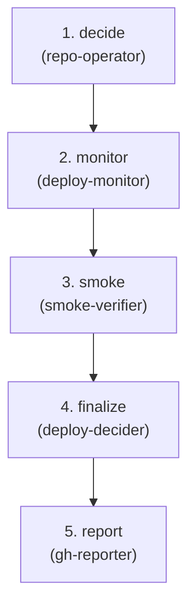

# Deploy — final judgment, landing and reconciliation

The command name is retained for compatibility. **Current responsibility:** make
a fresh post-qualification product/repository/integration judgment, perform only
the specifically authorized protected merge, and reconcile what actually landed.

Reacquire the current candidate, base, material findings and qualification
result. Confirm the implementation still fits accepted product direction and has
not been superseded. Reassess evidence applicability when shared interfaces,
configuration or integration relationships changed. An unrelated base movement
does not automatically require a rebase or complete proof replay.

A green Gate result is evidence, not merge permission. Use the installed
protected expected-head operation after the final judgment. There is no routine
auto-merge or merge queue in the selected design. Expected-head checking does
not atomically freeze the base; preserve the residual integration risk.

Read back the PR and actual landed commit/tree before reporting success. Do not
claim that qualification executed a different final squash composition. Do not
run a full suite merely because a merge occurred; separately admitted main
health, incidents, deep checks and release work retain their own owners.

Merge does not authorize tag creation, GitHub Release publication, package
publication, source promotion or production deployment. Those are separate
transactions with their own artifact identity, proof, credentials and rollback.
The historical generated topology below still combines these effects; it is not
the current authorization contract.

Reconcile the issue and remaining obligations. A source change can be complete
while packaging, installation or user-facing delivery remains unproven.

## Generated demo topology

This block is generated from `swarm/config/flows/deploy.yaml` and remains the
legacy demo/runtime topology pending #1463's config/runtime migration.

<!-- FLOW AUTOGEN START -->
### Flow structure

### Steps

| # | Step | Agents | Role |
| - | ---- | ------ | ---- |
| 1 | `decide` | `repo-operator` — Git workflows: branch, commit, merge, tag. Safe Bash only. | Merge PR to target branch, create git tag and GitHub release. Record actions in deployment_log.md. |
| 2 | `monitor` | `deploy-monitor` — Watch CI and deployment events | Watch CI/deployment events for the merge commit. Record CI status and deployment events in verification_report.md. |
| 3 | `smoke` | `smoke-verifier` — Run health checks and verify artifacts | Run health checks if endpoints available. Verify artifact/release existence. Append results to verification_report.md. |
| 4 | `finalize` | `deploy-decider` — Verify operationalization FRs (FR-OP-001..005) and issue deployment decision | Synthesize CI + smoke results into deployment_decision.md with status: STABLE/INVESTIGATE/ROLLBACK/NOT_DEPLOYED. |
| 5 | `report` | `gh-reporter` — Post summaries to GitHub issues/PRs at flow boundaries. | Post deployment summary to PR/issue to close the feedback loop. |
<!-- FLOW AUTOGEN END -->
