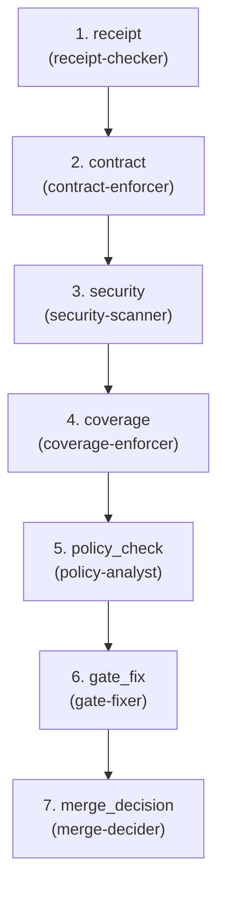

# Gate — explicit independent qualification

**Current responsibility:** Request and reconcile the remaining merge-relevant
proof for the selected reviewed candidate. Gate produces qualification evidence;
it does not decide or perform the merge.

Before allocating expensive work, bind the current repository, PR/head, review
and evidence generation, selected proof plan, requester authority and operation
identity. Ordinary open/update/reopen, Draft/Ready and unrelated labels are not
the request. A retained request or label for H1 cannot authorize H2.

For every declared obligation, execute it, reuse admissible compatible evidence,
prove it inapplicable, or retain it as blocked/not proven. Unknown impact widens
proof or blocks. An available audit catalogue is not an instruction to run every
check.

Admission acknowledgement, skipped jobs and empty execution are not successful
qualification. Preserve product failure, evidence failure, infrastructure loss,
cleanup failure and publication failure as separate outcomes. Read back the
native request/run/attempt; reconcile uncertain or duplicate delivery before
retrying.

The normal complete active run targets 20 minutes or less, including required
setup, selected children, evidence finalization and trusted result publication.
Queue latency and shifted warm-session work are separate measurements.

Do not modify the frozen candidate inside the independent transaction. Return
failures and findings to the warm writer. A successor requires affected review,
proof and a new explicit request. A complete result proceeds to Deploy for a
fresh product/repository/integration judgment—not an automatic merge.

## Generated demo topology

The generated block retains the previous audit-and-`merge_decision` topology for
runtime compatibility. Its terminal filename and agent name do not confer merge
authority under the current method.

<!-- FLOW AUTOGEN START -->
### Flow structure

### Steps

| # | Step | Agents | Role |
| - | ---- | ------ | ---- |
| 1 | `receipt` | `receipt-checker` — Verify build receipt exists and is complete | Verify build_receipt.json completeness → receipt_audit.md. |
| 2 | `contract` | `contract-enforcer` — Check API changes versus contracts | Check API changes versus contracts → contract_audit.md. |
| 3 | `security` | `security-scanner` — Run SAST and secret scans | Run SAST and secret scans → security_audit.md. |
| 4 | `coverage` | `coverage-enforcer` — Verify test coverage meets thresholds | Verify test coverage meets thresholds → coverage_audit.md. |
| 5 | `policy_check` | `policy-analyst` — Analyze policy compliance, regulatory requirements, and governance risks. | Check policy compliance → policy_audit.md. |
| 6 | `gate_fix` | `gate-fixer` — Mechanical fixes only (lint/format/docs) → gate_fix_summary.md. | Apply mechanical fixes only → gate_fix_summary.md. |
| 7 | `merge_decision` | `merge-decider` — Synthesize all checks into merge decision | Synthesize all checks into merge decision → merge_decision.md. |
<!-- FLOW AUTOGEN END -->
